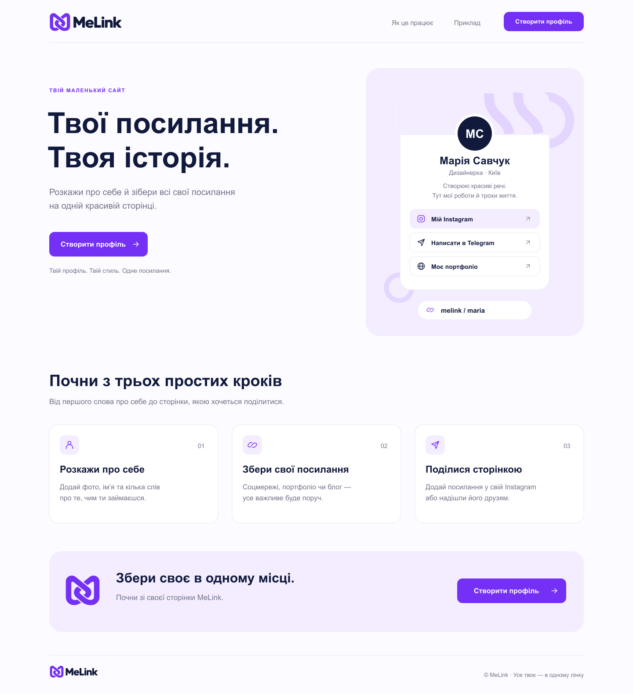
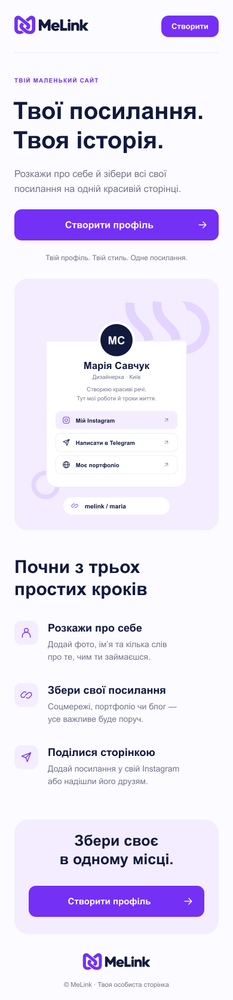

# MeLink

**MeLink — твоя персональна сторінка, де можна розповісти про себе й зібрати всі свої соціальні мережі та важливі посилання в одному місці.**

Навчальний вебпроєкт на Django. Наразі реалізований фронтенд головної сторінки: адаптивна верстка, приклад профілю, блок із трьома кроками та заклики до створення власної сторінки.

## Що вже зроблено

- Створено візуальний стиль MeLink: логотипи, SVG-іконки та фіолетова палітра.
- Підготовлено макети головної сторінки, профілю, реєстрації та редактора для комп’ютера й телефона.
- Налаштовано Django-проєкт `config` і застосунок `melink`.
- Зверстано головну сторінку з шапкою, навігацією та підвалом.
- Додано демонстраційну картку профілю із соціальними посиланнями.
- Оформлено блок «Почни з трьох простих кроків».
- Додано адаптивні стилі для різних розмірів екрана.

## Поточний стан

Головна сторінка відкривається через Django. Профіль Марії Савчук і соціальні посилання на ній — демонстраційні дані. Кнопки «Створити профіль» поки ведуть до блока на головній сторінці; створення, редагування та збереження профілів ще не реалізовані.

Макети інших сторінок у папці `design/` показують запланований вигляд продукту, але не означають, що відповідні функції вже працюють.

## Дизайн

### Головна сторінка — комп’ютер



<details>
<summary>Головна сторінка — телефон</summary>



</details>

Це зображення дизайн-макетів; поточна верстка може трохи відрізнятися текстами та переносами рядків.

- [Усі макети](design/)
- [Інструкція до макетів та імпорту SVG у Figma](design/README.txt)
- [Логотипи](image/logo/)

## Технології

- **Python 3.10+** та **Django 5.2** — основа проєкту й відображення сторінок.
- **Django Templates** — HTML-шаблони та підключення статичних файлів.
- **HTML5 і CSS3** — розмітка, Flexbox, Grid та адаптивність.
- **SVG** — логотипи й іконки.
- **SQLite** — база даних у стандартних налаштуваннях Django; дані профілів поки не зберігаються.

## Запуск локально

Потрібні Git і Python 3.10 або новіший. Поточне середовище розробки — Python 3.13.

### 1. Завантажити проєкт

```bash
git clone https://github.com/ivaniuk07/MeLink.git
cd MeLink
```

### 2. Створити віртуальне середовище

```bash
python3 -m venv venv
```

Активувати на macOS / Linux:

```bash
source venv/bin/activate
```

На Windows у PowerShell для створення й активації середовища:

```powershell
py -m venv venv
.\venv\Scripts\Activate.ps1
```

### 3. Встановити залежності

```bash
python -m pip install -r requirements.txt
```

### 4. Підготувати базу й запустити сервер

```bash
python manage.py migrate
python manage.py runserver
```

Відкрити [http://127.0.0.1:8000/](http://127.0.0.1:8000/).

## Структура проєкту

```text
MeLink/
├── config/                       # Налаштування й головні маршрути Django
├── melink/                       # Застосунок MeLink
│   ├── templates/melink/
│   │   └── index.html            # HTML головної сторінки
│   ├── static/melink/
│   │   ├── style.css             # Стилі та адаптація для телефона
│   │   └── images/               # Логотипи й іконки для сторінки
│   ├── urls.py                   # Маршрути застосунку
│   ├── views.py                  # Відображення сторінок
│   └── models.py                 # Майбутні моделі даних
├── design/                       # Макети SVG і PNG
├── image/logo/                   # Варіанти логотипів
├── manage.py                     # Команди Django
├── requirements.txt             # Залежності Python
├── .gitignore
└── README.md
```

## Де змінювати сторінку

- Текст і HTML: [`melink/templates/melink/index.html`](melink/templates/melink/index.html).
- Кольори, відступи та адаптивність: [`melink/static/melink/style.css`](melink/static/melink/style.css).
- Зображення: [`melink/static/melink/images/`](melink/static/melink/images/).

CSS містить коментарі до основних секцій. Медіазапити змінюють розташування елементів для телефона та планшета.

## Налаштування розробки

Проєкт налаштований для локального запуску з `DEBUG = True`. Ключ Django можна передати через змінну середовища `DJANGO_SECRET_KEY`. Якщо її не задано, генерується тимчасовий ключ для розробки; після перезапуску сервера він змінюється.

Віртуальне середовище, локальна база SQLite, файли `.env` та кеш Python не входять до репозиторію. Поточні налаштування не призначені для публічного розгортання.

## Подальші кроки

- [ ] Реєстрація та вхід користувачів.
- [ ] Створення й редагування профілю.
- [ ] Завантаження аватара та додавання опису.
- [ ] Додавання, редагування та видалення соціальних посилань.
- [ ] Збереження даних у базі.
- [ ] Публічна сторінка з унікальною адресою.
- [ ] Вибір оформлення профілю.

## Автор

[ivaniuk07](https://github.com/ivaniuk07)
